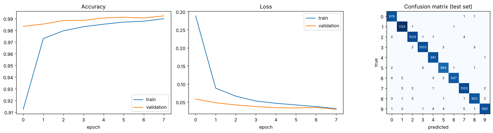
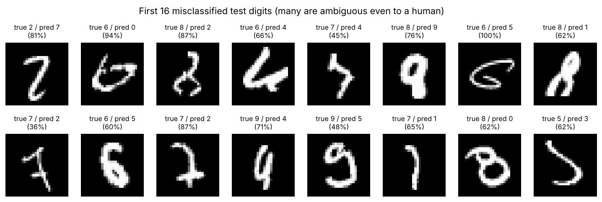
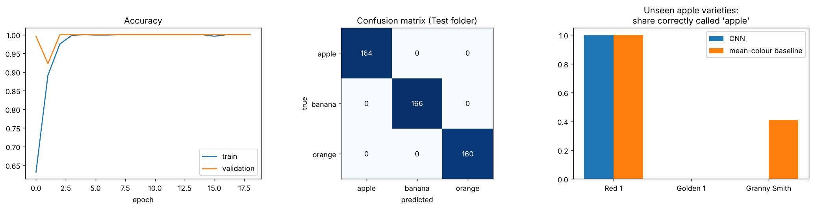
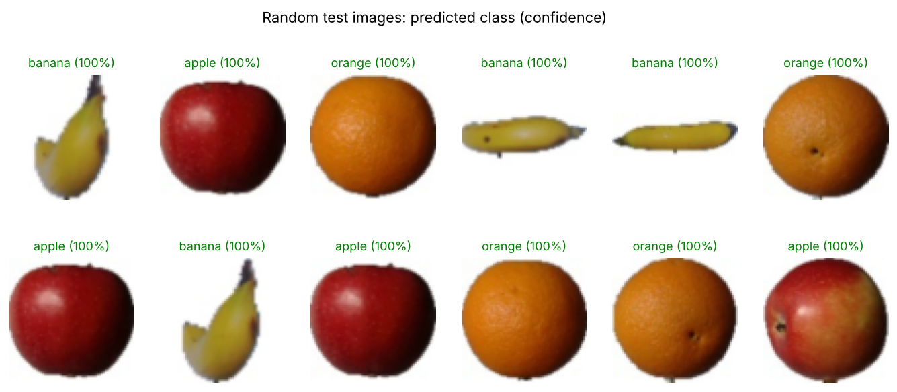

# Three Beginner ML Mini-Projects

Three small, self-contained machine-learning projects. Each one has its **own notebook**, and all three are also combined in one notebook:

| # | Project | Standalone notebook | Metrics file |
|---|---|---|---|
| 1 | **Handwritten Digit Recognizer**: a CNN trained on MNIST | [`01_mnist_digit_recognizer.ipynb`](01_mnist_digit_recognizer.ipynb) | `results_mnist.json` |
| 2 | **Speech-to-Text Transcription**: a transcription tool built on the `SpeechRecognition` library | [`02_speech_to_text.ipynb`](02_speech_to_text.ipynb) | `results_speech.json` |
| 3 | **Fruit Image Classifier**: a small CNN that separates apples, bananas and oranges | [`03_fruit_classifier.ipynb`](03_fruit_classifier.ipynb) | `results_fruit.json` |

All three together: [`ml_mini_projects.ipynb`](ml_mini_projects.ipynb) (metrics in `results.json`).

All notebooks in this folder have already been run, so outputs and plots are saved in them. The standalone notebooks reproduce the numbers below from the combined run (same accuracy, errors and word error rates). The only difference is that the fruit CNN's early stopping ended after 19 epochs in its standalone run instead of 25.

## Results at a glance

| Project | Model / tool | Result |
|---|---|---|
| Digit recognizer | CNN, 225,034 parameters, 8 epochs (~77 s on 2 CPU cores) | **99.23 % test accuracy** (77 errors out of 10,000 test images) |
| Speech-to-text | `SpeechRecognition` + PocketSphinx (offline) | Word error rate: **0 %** and **0 %** on two short clips, **27.3 %** on an 11-second speech |
| Fruit classifier | CNN, 27,939 parameters, 64x64 input | **100 % on the Test folder**, but **fails on unseen yellow/green apples** (see caveat) |

---

## 1. Handwritten Digit Recognizer

- **Data:** full MNIST, 60,000 training and 10,000 test images (28x28 grayscale), loaded from the original `.gz` files.
- **Model:** Conv(32) -> MaxPool -> Conv(64) -> MaxPool -> Dropout -> Dense(128) -> Dropout -> Dense(10). Adam optimizer, batch size 128, 8 epochs, 10 % of the training data held out for validation.
- **Result:** 99.23 % accuracy on the untouched test set (loss 0.024). Final validation accuracy was 99.23 %, so there is no sign of overfitting.
- **Weakest digit:** 9 (98.1 % recall). Strongest: 4 and 1 (99.9 % and 99.8 %).
- Includes `predict_digit_from_image(path)` to classify your own drawing. The notebook demonstrates it on an MNIST digit saved as a PNG; I have not tested it on real hand-drawn photos, so expect lower accuracy on those (lighting, pen width and background all matter).





## 2. Speech-to-Text Transcription

- **Tool:** `transcribe(wav_path, engine="sphinx" | "google")` wraps the `SpeechRecognition` library. Clips are first converted to 16 kHz mono WAV with a proper resampler (`prepare_wav`).
- **Evaluation:** three public clips with known transcripts, scored by word error rate (WER, lower is better).

| Clip | Length | Reference | PocketSphinx output | WER |
|---|---|---|---|---|
| `goforward` | 2.8 s | go forward ten meters | go forward ten meters | **0 %** |
| `english` | 2.7 s | one two three | one two three | **0 %** |
| `jfk` | 11.0 s | and so my fellow americans ask not what your country can do for you ask what you can do for your country | and i got my fellow americans ask not what your kind brain can do for you and when you can do for your country | **27.3 %** (6 of 22 words wrong) |

- **Google engine not tested:** the Google Web Speech API (`engine="google"`) needs internet access, which was not available where this was run, so the notebook reports it as unreachable. On your machine it will run automatically and add a Google column (set `TRY_GOOGLE = False` to skip it).
- **Preprocessing matters:** passing the original 44.1 kHz FLAC file straight to the library gave a much worse transcript (**72.7 % WER** vs 27.3 % after careful resampling). I did not isolate the cause; the library's built-in rate conversion is the likely suspect.
- **Small test:** with only three clips (and two of them very short and clean), these numbers show the tool works but are not a reliable accuracy benchmark. Offline PocketSphinx is generally less accurate than online engines, especially on longer, natural speech.
- Includes `listen_and_transcribe()` for microphone input (needs the optional `pyaudio` package; defined but not run).

## 3. Fruit Image Classifier

- **Data:** the Fruits-360 images (Horea Muresan & Mihai Oltean, [Horea94/Fruit-Images-Dataset](https://github.com/Horea94/Fruit-Images-Dataset); check the repo for license terms), one fruit per 100x100 photo on a white background. Classes: apple (Braeburn variety), banana, orange. Images are resized to 64x64.

| Split | Images |
|---|---|
| Train | 1,241 |
| Validation (random 15 % of Training folder) | 220 |
| Test (dataset's own Test folder) | 490 (164 apple / 166 banana / 160 orange) |

- **Model:** 3 conv blocks (16/32/64 filters) -> global average pooling -> Dense(64) -> Dropout -> softmax, with random flip/rotation/zoom augmentation during training. Ran 25 epochs in ~49 s.
- **Result on the Test folder:** 100 % accuracy (0 errors out of 490).

### Important caveat: the 100 % is misleading

1. **A trivial baseline also scores 100 %.** Logistic regression on just the average colour of each image gets 100 % on the same test set. The three fruits are easy to tell apart by colour, and the Test folder contains near-duplicate frames of the same fruits seen in training (the fruits were photographed rotating on a turntable).
2. **The model does not generalise to other apple varieties.** I tested it on three apple varieties it never saw. Every image is an apple:

| Unseen variety | Images | CNN called it "apple" | Mean-colour baseline called it "apple" |
|---|---|---|---|
| Apple Red 1 | 164 | 100 % | 100 % |
| Apple Golden 1 | 160 | **0 %** (all called banana) | 0 % |
| Apple Granny Smith | 164 | **0 %** (all called banana) | 41 % |

With only one apple variety (Braeburn, mostly red/yellow) in training, the CNN effectively learned colour rules: yellow-green things become "banana". To make this classifier genuinely useful, train on several varieties per fruit, validate on whole held-out varieties instead of random frames, and add more fruit classes.





---

## How to run

```bash
pip install -r requirements.txt
jupyter notebook                              # open any notebook, then Run All
```

Run any of `01_…`, `02_…`, `03_…` on its own, or `ml_mini_projects.ipynb` for all three at once. The notebooks share the `data/` cache, so nothing is downloaded twice.

- Needs internet on the first run: MNIST, the fruit images and the three audio clips are downloaded (about 30 MB) from GitHub into `data/` and cached, so later runs skip the download. Fruit downloads take about 40 seconds.
- Takes roughly 5 minutes on a 2-core CPU; no GPU needed. Results may differ slightly from those above (random initialisation and CPU floating-point differences), though the seeds are fixed.

## Folder contents

```
ml-mini-projects/
├── 01_mnist_digit_recognizer.ipynb   # project 1 on its own
├── 02_speech_to_text.ipynb           # project 2 on its own
├── 03_fruit_classifier.ipynb         # project 3 on its own
├── ml_mini_projects.ipynb            # all three in one notebook
├── README.md                # this file
├── requirements.txt         # Python dependencies
├── results.json             # metrics from the combined notebook
├── results_mnist.json / results_speech.json / results_fruit.json   # metrics from each standalone notebook
├── images/                  # figures used above (+ demo_digit.png)
├── models/                  # trained models: mnist_cnn.keras, fruit_cnn.keras
└── data/                    # downloaded datasets/audio (created on first run)
```

## Data and audio sources

- **MNIST:** Yann LeCun, Corinna Cortes, Christopher Burges. Original files, loaded from the GitHub mirror [fgnt/mnist](https://github.com/fgnt/mnist).
- **Fruits-360:** Horea Muresan and Mihai Oltean, [Horea94/Fruit-Images-Dataset](https://github.com/Horea94/Fruit-Images-Dataset).
- **Audio clips:** `jfk.flac` from [openai/whisper](https://github.com/openai/whisper) test files; `goforward.raw` from [cmusphinx/pocketsphinx](https://github.com/cmusphinx/pocketsphinx) test data; `english.wav` from the [SpeechRecognition](https://github.com/Uberi/speech_recognition) examples.
